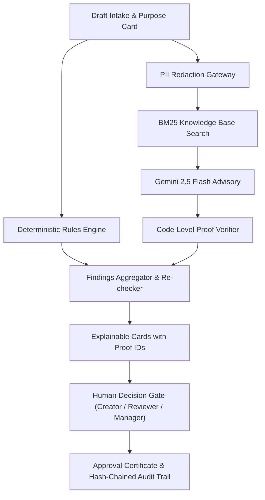

# Pramaan (प्रमाण)
### Evidence-Backed Brand Governance Platform for Pre-Publication Content Review

[](https://github.com/Sitanshudevop/Pramaan/actions/workflows/ci.yml)
[](LICENSE)
[](https://python.org)
[](https://fastapi.tiangolo.com)
[](https://react.dev)
[](https://www.typescriptlang.org)
[](https://tailwindcss.com)

> *"Every finding has evidence. Every correction preserves the creator’s purpose. Every final decision remains human."*

---

## 1. What is Pramaan?

**Pramaan** (Hindi for *“proof, evidence”*) is a pre-publication brand-governance web platform developed for **CodeNexus India 2026 Round 2 (The Build)** by team **DOOM_CODER** (Solo participant: Sitanshu Kumar).

Modern brand content is authored by distributed teams, agencies, and generative AI. Traditional brand books sit unopened in static PDFs while outdated claims, unverified pricing, tone drift, and missing disclosures reach production.

Pramaan replaces post-publication damage control with an **evidence-or-abstain** pre-flight workspace:
1. **Proof for every finding:** 100% of displayed findings cite a verified Rule ID or Fact ID. In the absence of an approved source, Pramaan abstains (`Unsupported` or `Needs human judgement`).
2. **Intent-preserving suggestions:** Corrections are generated with locked key phrases and re-verified against the original rule and Creator Purpose Card.
3. **Living brand knowledge & ambiguity radar:** Overrides and reviewer disagreements are tracked to highlight vague guidelines and propose clearer wording.
4. **Connected 8-week demo story:** Deterministic seed engine (`backend/app/seed/demo_story.py`) runs 36 reviews through the real service layer across 6 team personas, generating genuine cryptographic audit trails, disclosure ledger entries, and cross-workspace insights.
5. **Zero-login persona switching:** Test immediately with 6 distinct team personas (`Admin`, `Brand manager`, `Reviewer`, `Creator`) with strict server-side permission checks.
6. **Works without an AI key:** Pure deterministic rules produce genuine findings; graceful degradation if `GEMINI_API_KEY` is omitted or in Confidential Mode.
7. **Fully responsive design:** Calm, uncluttered experience from 320 px phones up to 2560 px ultra-wide displays with accessible hamburger navigation, icon rail, and responsive building blocks.

---

## 2. 5-Step Demo Walkthrough (for Judges)

You can test Pramaan immediately in any browser (including Incognito) with **zero login**:

1. **Step 1: Open the App & Choose a Persona / Sample**
   - Navigate to `/` (Home) or click **New Review** (`/app/new`).
   - Use the **"View as"** menu in the top bar to switch between 6 fictional team personas:
     - **Meera Kapoor** (*Admin*): Owns settings, team invites, and retention.
     - **Anika Rao** (*Brand manager*): Publishes rules and issues final approvals.
     - **Rohan Mehta** (*Reviewer*): Reviews *Kettle & Co.* content and records overrides.
     - **Dev Malhotra** (*Reviewer*): Reviews *LedgerLeaf* content with a compliance mindset.
     - **Priya Nair** (*Creator*): Social and email drafts for *Kettle & Co.*
     - **Imran Sheikh** (*Creator*): App notifications and landing copy for *LedgerLeaf*.
   - Click one of the one-click sample buttons (e.g. *"Sample 1: Kettle & Co."* or *"Sample 2: LedgerLeaf"*). The Purpose Card and draft auto-populate with the correct brand identity.
2. **Step 2: Run Review & Inspect Evidence Cards**
   - Click **Run Review**.
   - Review findings load in milliseconds. Each card displays:
     - Exact flagged excerpt with character offsets.
     - Severity badge (`Blocker`, `Major`, `Minor`, `Info`).
     - Verification method (`DETERMINISTIC`, `AI`, or `HYBRID`) and confidence percentage.
     - **Exact evidence citation** (e.g., `CLAIM-1.1`, `TERM-001`, `F-01`).
3. **Step 3: Accept a Purpose-Preserving Fix & Review Diff**
   - Inspect the inline suggestion on a finding.
   - Click **Accept Suggestion**. A new draft version (v2) is spawned, checks automatically re-run, locked phrases remain intact, and a unified diff highlights changes.
4. **Step 4: Switch Roles & Enforce Governance Gates**
   - Switch personas in the top bar from `Creator` to `Reviewer` or `Brand manager`.
   - As a `Reviewer`, add a comment or override a finding (mandatory justification reason required).
   - As a `Brand manager`, sign off on the review. If a `Blocker` finding remains unresolved, unauthorized lower-role sign-off is blocked.
5. **Step 5: Download Certificate & Verify Audit Integrity**
   - Click **Certificate** to inspect the tamper-evident proof record.
   - Navigate to **Audit & Disclosure** (`/app/audit`) to view the hash-chained audit log and AI disclosure ledger. Click **Verify Trail Integrity** to confirm the SHA-256 cryptographic chain.

---

## 3. Quickstart & Local Setup

### Prerequisites
- Python 3.12+ (or 3.11+)
- Node.js 20+ and npm
- (Optional) `GEMINI_API_KEY` in environment for live Gemini 2.5 Flash calls. If unset, Pramaan runs in deterministic fallback mode.

### Backend Setup
```bash
# Clone the repository
git clone https://github.com/Sitanshudevop/Pramaan.git
cd Pramaan

# Create and activate virtual environment
python -m venv backend/venv

# Windows:
backend\venv\Scripts\activate
# Linux/macOS:
source backend/venv/bin/activate

# Install dependencies
pip install -r backend/requirements.txt

# Run backend API server (runs on http://localhost:8000)
cd backend
uvicorn app.main:app --reload --port 8000
```

### Frontend Setup
```bash
# In a new terminal window
cd frontend

# Install dependencies
npm install

# Start Vite development server (runs on http://localhost:5173)
npm run dev
```

Open `http://localhost:5173` in your browser.

---

## 4. One-Command Docker Run

You can run the entire full stack with Docker Compose:
```bash
docker-compose up --build
```
- Frontend: `http://localhost:5173`
- Backend API Docs: `http://localhost:8000/docs`

---

## 5. Technology Stack

| Layer | Technology | Purpose |
|---|---|---|
| **Frontend** | React 18, TypeScript (Strict), Vite, Tailwind CSS | High-performance, zero-friction pre-publication workspace |
| **State & Query** | TanStack React Query v5 | Optimistic UI updates, caching, automatic query invalidation |
| **Icons & Design** | Lucide React | Minimalist, calm editorial typography and iconography |
| **Backend Framework** | FastAPI (Python 3.12), Pydantic v2 (`extra="forbid"`) | High-speed async API, strict schema validation |
| **ORM & Database** | SQLAlchemy 2.0, SQLite (`pramaan.db`) | Single-file zero-dependency database seeded on startup |
| **Grounding & NLP** | `rank_bm25`, `textstat`, custom PII regex gateway | Deterministic rule matching, readability scoring, PII redaction |
| **AI Integration** | Google Gemini API (Gemini 2.5 Flash) | Advisory judgement strictly behind code-level proof verifiers |
| **Security** | `slowapi` rate limits, strict CSP & security headers | Production-grade perimeter protection and role-based access |

---

## 6. Architecture & Grounding Pipeline



---

## 7. Responsive Multi-Device Design & Screenshots

Pramaan is mobile-first, uncluttered, and adaptive across viewports from **320 px up to 2560 px ultra-wide**:
- **Mobile (< 1024 px):** Accessible off-canvas hamburger navigation drawer (`role="dialog"`, `aria-label="Navigation Menu"`, focus trapped, swipe-to-close, body scroll lock, Esc close). Adaptive top bar with bottom sheet / popover overflow.
- **Laptop (1024 – 1279 px):** Collapsed 72 px icon rail with accessible tooltips, toggles to 240 px sidebar.
- **Desktop (≥ 1280 px):** Expanded 240 px sidebar with one-click rail collapse, choice saved in `localStorage`.
- **Reusable Building Blocks:** `BottomSheet`, `ScrollTabs`, `AccordionItem`, `ResponsiveTable`, `StickyActionBar`, `Truncate`.
- **Zero Horizontal Overflow:** Verified across 13 distinct viewports (320px, 360px, 390px, 414px, 600px, 768px, 820px, 1024px, 1280px, 1440px, 1920px, 2560px, and landscape 844×390px). Touch targets ≥ 44×44px.

| Screen | Mobile (390px) | Tablet (768px) | Desktop (1440px) |
|---|---|---|---|
| **Home** | [Screenshot](docs/screenshots/home_mobile_390px_dark.png) | [Screenshot](docs/screenshots/home_tablet_768px_dark.png) | [Screenshot](docs/screenshots/home_desktop_1440px_dark.png) |
| **New Review** | [Screenshot](docs/screenshots/new_review_mobile_390px_dark.png) | [Screenshot](docs/screenshots/new_review_tablet_768px_dark.png) | [Screenshot](docs/screenshots/new_review_desktop_1440px_dark.png) |
| **Review Queue** | [Screenshot](docs/screenshots/review_queue_mobile_390px_dark.png) | [Screenshot](docs/screenshots/review_queue_tablet_768px_dark.png) | [Screenshot](docs/screenshots/review_queue_desktop_1440px_dark.png) |
| **Brand Knowledge Hub** | [Screenshot](docs/screenshots/brand_hub_mobile_390px_dark.png) | [Screenshot](docs/screenshots/brand_hub_tablet_768px_dark.png) | [Screenshot](docs/screenshots/brand_hub_desktop_1440px_dark.png) |
| **Review Findings** | [Screenshot](docs/screenshots/review_findings_mobile_390px_dark.png) | [Screenshot](docs/screenshots/review_findings_tablet_768px_dark.png) | [Screenshot](docs/screenshots/review_findings_desktop_1440px_dark.png) |
| **Audit & Disclosure** | [Screenshot](docs/screenshots/audit_disclosure_mobile_390px_dark.png) | [Screenshot](docs/screenshots/audit_disclosure_tablet_768px_dark.png) | [Screenshot](docs/screenshots/audit_disclosure_desktop_1440px_dark.png) |
| **Insights** | [Screenshot](docs/screenshots/insights_mobile_390px_dark.png) | [Screenshot](docs/screenshots/insights_tablet_768px_dark.png) | [Screenshot](docs/screenshots/insights_desktop_1440px_dark.png) |
| **Settings** | [Screenshot](docs/screenshots/settings_mobile_390px_dark.png) | [Screenshot](docs/screenshots/settings_tablet_768px_dark.png) | [Screenshot](docs/screenshots/settings_desktop_1440px_dark.png) |

---

## 8. Automated Testing & Verification

Pramaan maintains rigorous test suites across both backend and frontend:

- **Backend Pytest (`backend/tests/`):** 35/35 passed (100% green). Tests cover pure deterministic checks, golden sample runs, security and PII gates, multi-tenant workspace isolation, settings management, and the 8-week demo story generator.
- **Backend Lint & Types:** Clean `ruff check .`, `ruff format --check .`, and `mypy app/` (0 issues across 46 source files).
- **Playwright E2E Suites (`frontend/tests/`):**
  - [`viewport-sweep.spec.ts`](frontend/tests/viewport-sweep.spec.ts): Verifies zero horizontal overflow across 13 screen sizes (320px to 2560px) and asserts touch targets ≥ 44×44px.
  - [`hamburger-nav.spec.ts`](frontend/tests/hamburger-nav.spec.ts): Verifies off-canvas drawer opening/closing, focus trapping, scroll locking, 72px rail mode, and topbar adaptation.
  - [`review-submission.spec.ts`](frontend/tests/review-submission.spec.ts): Verifies role-based submission permissions (403 handling), inline validation for empty drafts, and automatic role switching.
  - [`interaction.spec.ts`](frontend/tests/interaction.spec.ts): Comprehensive 12-test suite verifying navigation, theme cycling, confidential toggles, Brand Hub, Audit exports, and automated Axe accessibility audits (0 critical violations).

Run the tests locally:
```bash
# Run backend tests
cd backend && pytest tests/

# Run frontend tests
cd frontend && npx playwright test
```

---

## 9. Submission & Governance Documentation

All required submission documents are stored in `/docs` and accessible within the app:

- [`docs/ARCHITECTURE.md`](docs/ARCHITECTURE.md): Architectural diagram, data pipeline, design decisions, and threat model.
- [`docs/FEATURES_COMPLETED.md`](docs/FEATURES_COMPLETED.md): Honest feature-by-feature verification matrix.
- [`docs/INTERACTION_CHECKLIST.md`](docs/INTERACTION_CHECKLIST.md): Complete interactive elements inventory with responsive specifications.
- [`docs/CHANGES_FROM_PLAN.md`](docs/CHANGES_FROM_PLAN.md): Log of adjustments made between Round 1 and Round 2.
- [`docs/ROUND3_IMPROVEMENTS.md`](docs/ROUND3_IMPROVEMENTS.md): Committed improvements for Round 3 (The Finish).
- [`docs/AI_AND_TOOLS_DISCLOSURE.md`](docs/AI_AND_TOOLS_DISCLOSURE.md): Complete disclosure of all AI models, tools, and libraries used.
- **Plan & Project Scope:** Plan pages replaced by a single About page (`/about`) to keep the product user-focused; the full plan is in the submitted PDF and [`docs/PRAMAAN_CONTENT.md`](docs/PRAMAAN_CONTENT.md).

---

## 10. Open Disclosures & Known Limitations

1. **Advisory Tool:** Pramaan is designed to augment human reviewers, not replace legal or regulatory counsel.
2. **Pass Sentence:** *"A pass means only that no issue was detected by the checks performed."*
3. **Approval Notice:** *"Approval records a human decision; it is not a legal compliance certification."*
4. **Fictional Demo Data:** Brand kits for *Kettle & Co.* and *LedgerLeaf*, including all simulated events, are entirely fictional.

---

## 11. Author & Team Information

- **Team Name:** DOOM_CODER
- **Team Size:** Solo participant
- **Team Lead:** Sitanshu Kumar
- **Affiliation:** B.Tech Computer Science Engineering (2024–2028), Rungta International Skill University, Durg, Chhattisgarh
- **Event:** CodeNexus India 2026 — Round 2 (The Build)
