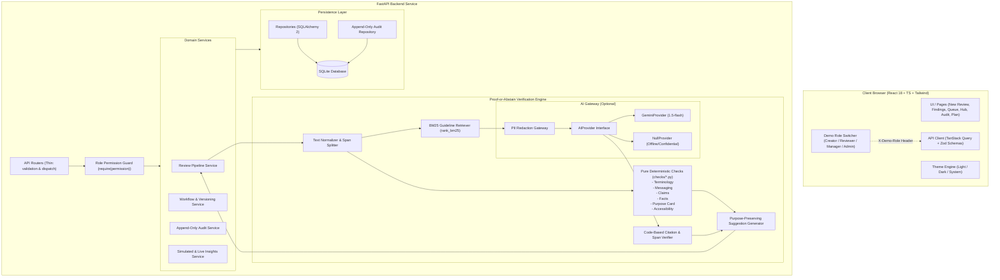

# Pramaan System Architecture

## 1. High-Level Architecture Overview

Pramaan is built on a clean three-tier separation of concerns:
1. **Frontend Presentation Layer**: React 18, TypeScript, Tailwind CSS, TanStack Query, and Vite.
2. **API & Workflow Layer**: FastAPI, Pydantic v2 schemas (`extra="forbid"`), role-based permission dependencies, and workflow state machines.
3. **Engine & Data Layer**: Pure deterministic check engine, BM25 retrieval indexer, AI Provider abstraction with PII sanitization and verification guard, and SQLite database with append-only audit trail.

---

## 2. Review Pipeline Data Flow

When a creator submits text and a purpose card to `POST /api/reviews`:
1. **Request Validation**: Pydantic validates length (max 20k chars), mandatory purpose fields, content type, and AI declaration.
2. **Normalisation**: Content is decomposed into sentence and paragraph blocks with precise character offsets (`start`, `end`).
3. **Deterministic Evaluation**: Pure check functions scan the text against approved brand kit rules (banned terms, product casing, mandatory disclaimers, superlative/absolute claims, and facts matching).
4. **BM25 Retrieval**: Top-k active rules and facts relevant to the brand kit and content type are retrieved.
5. **PII Redaction & AI Call (Optional)**: If `GEMINI_API_KEY` is present and Confidential Mode is OFF, PII (emails, phone numbers, identity numbers) is redacted into placeholders. Gemini evaluates tone, nuance, and semantic claims within `<<<CONTENT>>>` data blocks.
6. **Code-Level Verification**: Any finding from AI is verified in Python:
   - Does the cited rule ID or fact ID exist in the brand kit? (If not, drop it).
   - Does the quoted span exist literally in the source text? (If not, drop it).
   - Does the suggested severity exceed the rule specification? (If so, downgrade it).
   - If evidence is missing, mark as `Unsupported` or `Needs human judgement` — never invent "false".
7. **Suggestion & Purpose Preservation**: For flagged passages, suggestions are checked against locked phrases from the Purpose Card. If a locked phrase is violated, the suggestion is tagged as "Alternative, needs human judgement".
8. **Storage & Audit**: Finding records are persisted, and an append-only audit event is recorded without raw draft text.

---

## 3. Key Technical Decisions & Justifications

- **SQLite instead of Postgres**: Eliminates external database service failures, network hops, and container startup issues. Allows instant in-memory testing for unit and integration suites.
- **Pure Functions for Checks**: Every check in `app/checks/` takes `(text, rules, facts, purpose_card)` and outputs `list[Finding]`. No database calls, no network requests, no state mutations. This guarantees 100% test reproducibility and sub-millisecond execution.
- **Proof-or-Abstain Principle**: Rather than relying on AI self-consistency, verification happens strictly in deterministic Python code. A finding without valid evidence is dropped or flagged for human review.
- **Role Switcher with Server-Side Enforcement**: Eliminates authentication friction for judges while maintaining zero-trust server boundaries via `require(permission)` dependencies on every mutating route.
- **Single Accent Color Theme System**: Modern, editorial design system using CSS variables with strict WCAG AA contrast (4.5:1) in both light and dark themes. Zero external font layout shifts via fallback system stacks.
